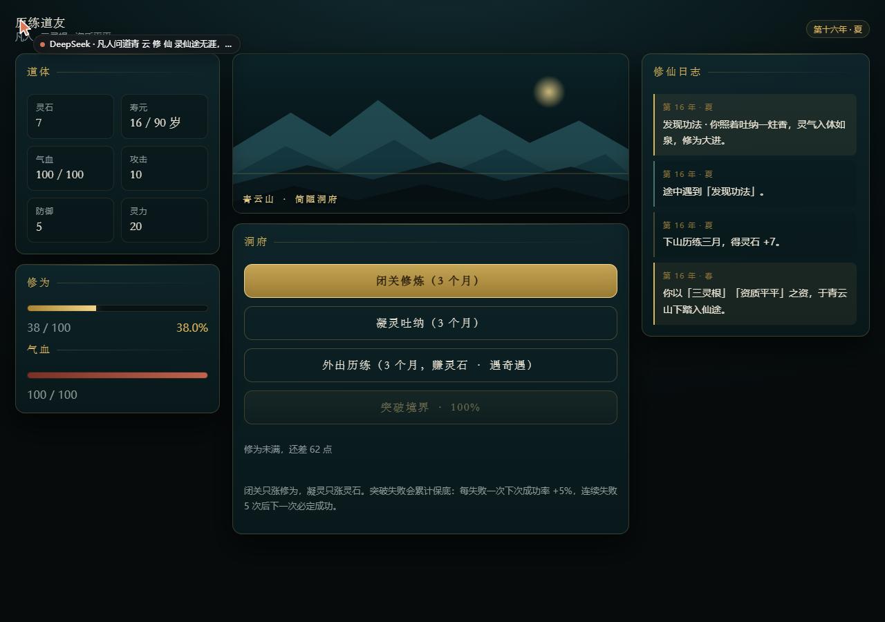
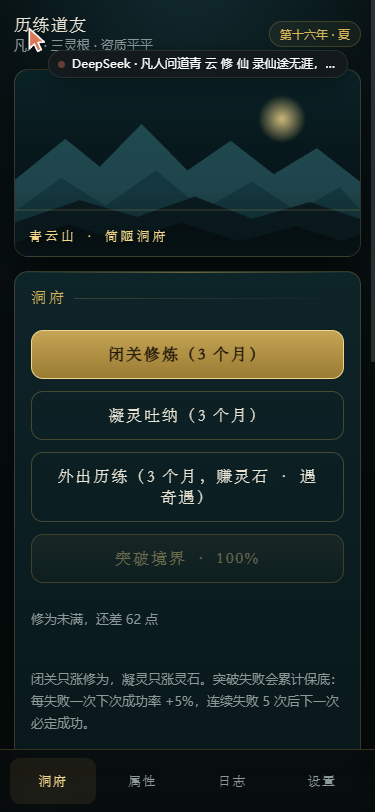
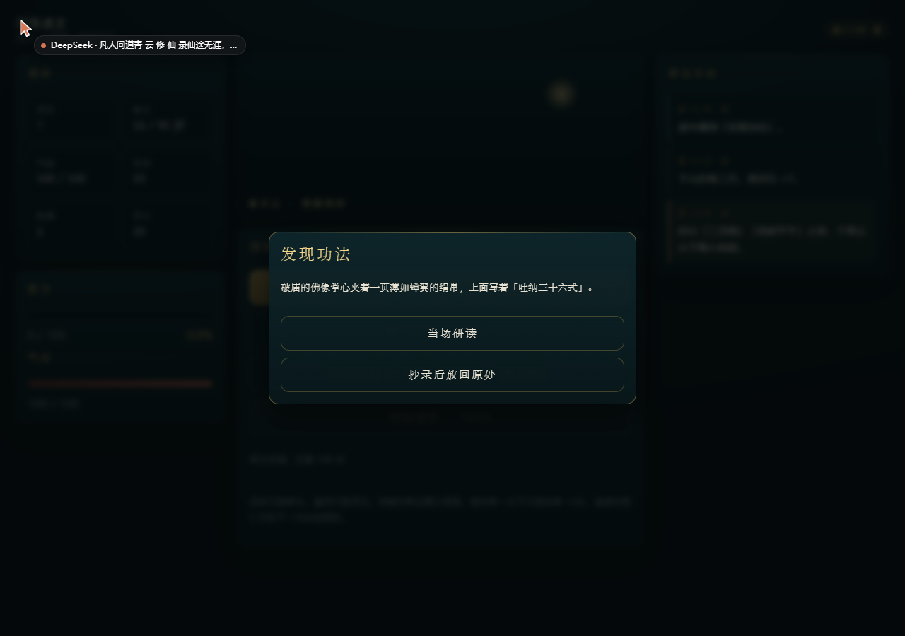
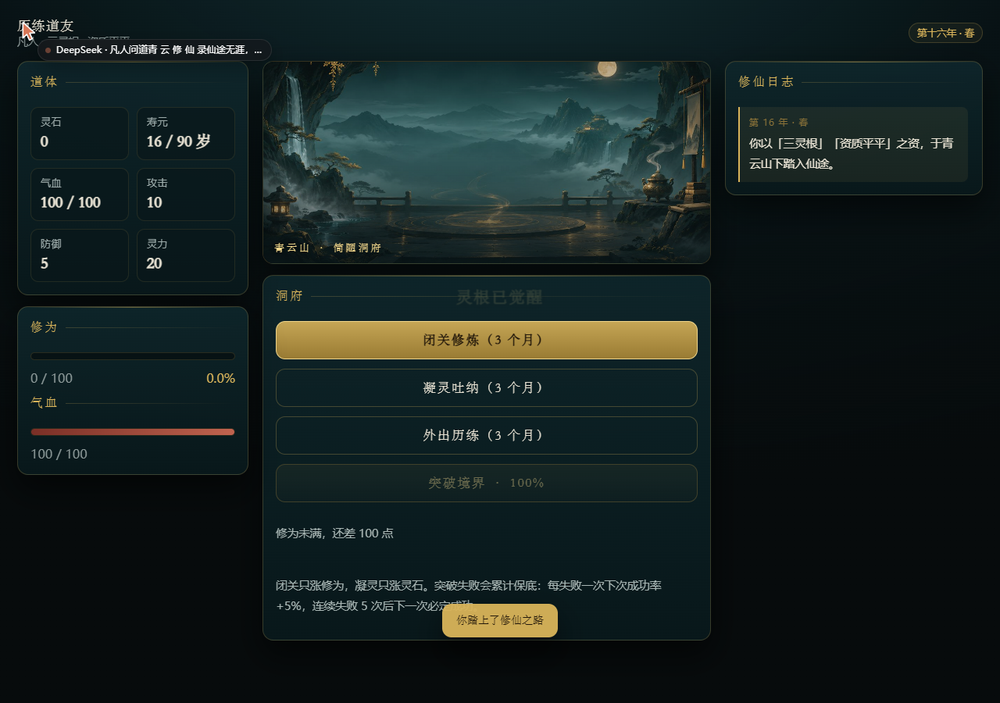
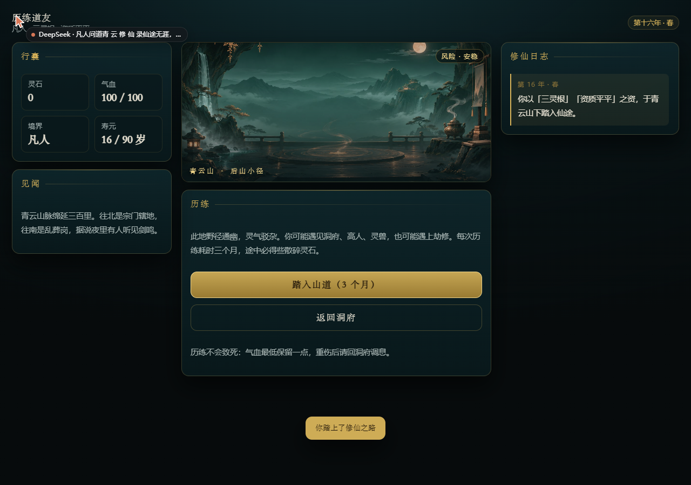
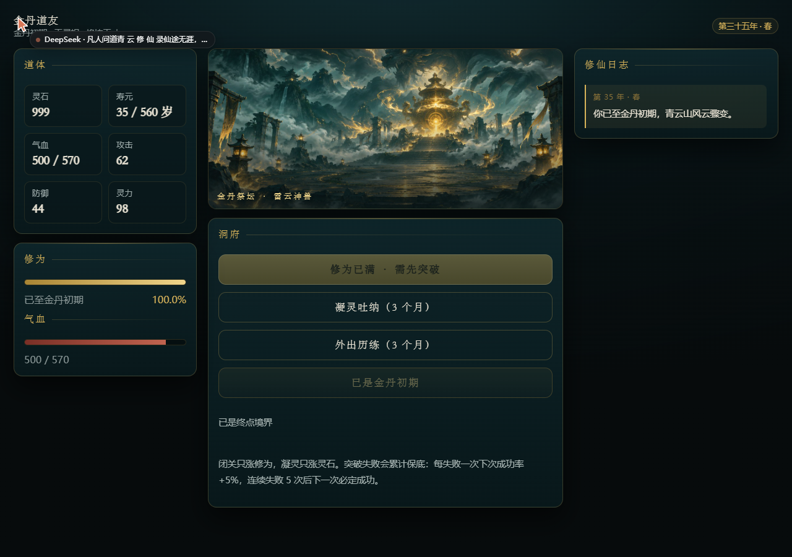
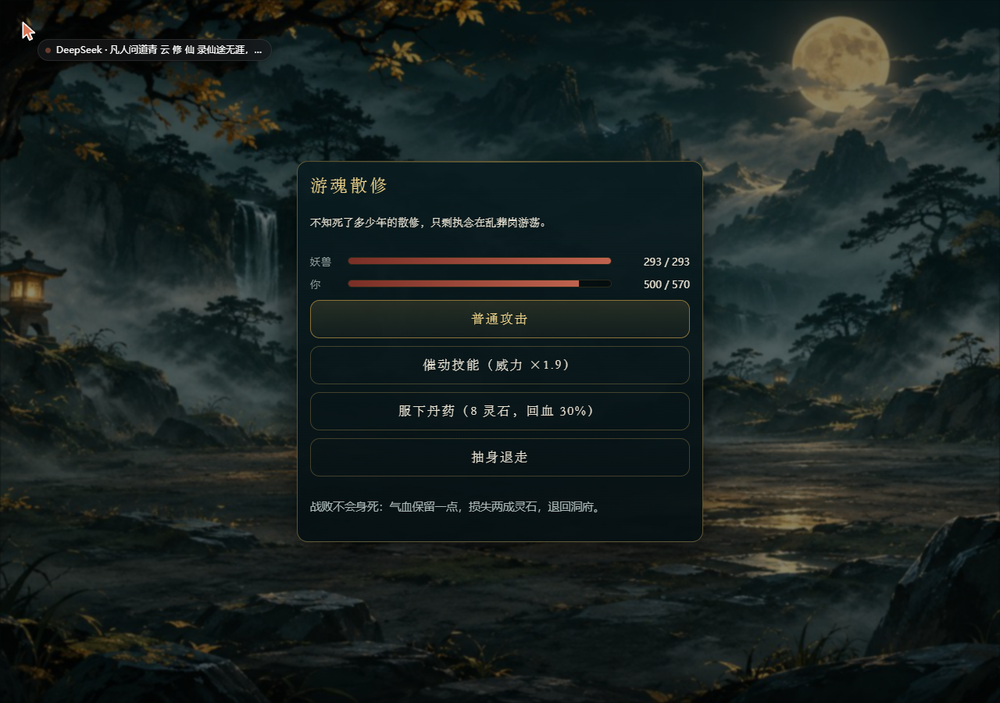

# 凡人问道 · 青云修仙录

免费网页版文字修仙游戏。零服务器、零付费 API、零数据库，进度存在浏览器本地。

**当前版本：v0.9.0（Boss 场景 + 战斗背景 + 休养）**

---

## 一、v0.2.0 修了什么（针对上一轮评审）

| 评审意见 | 处理 | 状态 |
|---|---|---|
| 闭关既是修为来源又是灵石来源，经济不自洽 | 拆成两个行动：**闭关**只产修为，**凝灵吐纳**只产灵石；修为满时闭关被拒绝，不再空转 | ✅ |
| 修为满后无意义操作 | 满修为时闭关按钮禁用并提示「先去突破或凝灵」 | ✅ |
| 经济软锁风险（修为满、灵石不足） | 凝灵永远可用且不致死，写成不变量测试；1000 种子模拟 0 软锁 | ✅ |
| 突破缺软保底 | 连续失败每次 +5 个百分点，**连续失败 5 次后下一次必定成功**；计数入存档、成功清零 | ✅ |
| 成功率曲线不单调 | 重排为单调递减：0.92 → 0.88 → … → 0.58（炼气），0.54 / 0.50 / 0.45（筑基），大境界额外降 6pp | ✅ |
| 失败惩罚过重 | 修为损失 30% → **25%**；气血 -20%、耗时 +6 个月不变，仍不致死 | ✅ |
| 灵石收支不平 | 突破总成本 210 → **100**；凝灵收益随灵根缩放，高灵根不再更缺钱 | ✅ |
| 行动结算散乱 | 新增 `core/actions.js` 的 `resolveAction(character, action, rng)` → `{ ok, error, events }`，UI 只发起行动、只渲染事件 | ✅ |
| 存档无版本迁移 | `SAVE_VERSION = 2` + 迁移表，v1 存档自动升级并补齐 `pity` 字段，迁移失败保留原档 | ✅ |
| 构建未验证 | 用 Vite（rollup-only，关闭 esbuild）产出 `dist/`，在 Chromium 真实加载并操作通过 | ⚠️ 见下 |

### 构建这件事必须说清楚

- **已验证**：`dist/index.html` + `dist/assets/*` 由 Vite 5.4 打包生成（13 个模块，JS 41.6 kB / gzip 14.3 kB），我把它挂在静态服务器上、在真实 Chromium 里走完了「创建角色 → 闭关 → 凝灵 → 存档」流程，无横向溢出、无报错。
- **未验证**：`npm run build` 的**默认配置**（含 esbuild 压缩）在我的执行环境里跑不了——沙箱禁止启动子进程，esbuild 报 `spawn EPERM`。我改用 `esbuild: false` + 不压缩的方式完成打包验证，产物可运行，但**没有验证压缩链路**。
- 请你在本机跑一次 `npm run build`，输出应该是 `dist/index.html` + 一个 JS + 一个 CSS，然后 `npm run preview` 打开确认。

## 二、怎么运行

```bash
npm install        # 只装 vite
npm run dev        # 开发服务器
npm run build      # 生产构建
npm run preview    # 预览产物
npm test           # 单元测试（36 项）
node scripts/simulate.mjs 1000   # 平衡模拟：5 种组合 × 1000 个固定种子
```

> 不装依赖也能跑：纯原生 ESM + CSS，任意静态服务器指向项目根目录即可。

## 三、当前玩法（阶段一）

1. 欢迎页 → 开始问道 / 继续前缘
2. 创建角色：随机灵根（天 / 双 / 三 / 五行杂）+ 天赋（修炼天才 / 炼丹奇才 / 福缘深厚 / 体魄强健 / 资质平平），可无限重掷
3. 洞府：
   - **闭关修炼**（3 个月）：涨修为，修为满时禁用
   - **凝灵吐纳**（3 个月）：涨灵石，突破材料唯一来源（阶段二由历练接替）
   - **突破境界**：显示实时成功率（含软保底加成）
4. 属性 / 日志 / 设置（手动保存、导出导入 JSON、二次确认重置）
5. 寿元耗尽 → 「道消」结局页

## 四、文件结构

```
fanren-wendao/
├── index.html
├── package.json
├── README.md
├── docs/DESIGN.md              设计文档与数值表
├── scripts/simulate.mjs        平衡模拟（多组合 × 多种子）
├── src/
│   ├── main.js
│   ├── core/
│   │   ├── rng.js              可注入种子的确定性随机
│   │   ├── gameState.js        角色创建、派生属性、时间、日志、越界修正
│   │   ├── actions.js          统一行动结算入口 resolveAction
│   │   ├── cultivation.js      闭关修炼 + 凝灵吐纳
│   │   ├── breakthrough.js     突破判定、失败惩罚、软保底
│   │   └── saveManager.js      序列化 / 迁移 / 校验 / 导入导出
│   ├── data/
│   │   ├── realms.js           境界数值（单一来源）
│   │   └── backgrounds.js      灵根、天赋
│   └── ui/
│       ├── ui.js               渲染与事件
│       └── styles.css          古风视觉
└── tests/                      36 项单元测试（node:test，单进程入口 run.mjs）
    ├── cultivation.test.js
    ├── breakthrough.test.js
    ├── save.test.js
    ├── balance.test.js
    └── run.mjs
```

## 五、存档

- 存储键 `fanren-wendao:save`，**版本 2**
- v1 存档会被自动迁移（补 `pity` 字段），迁移失败则拒绝导入且不动当前进度
- 导入校验：版本、角色名、灵根/天赋 id、境界 id、数值类型与范围、修为不得超上限、气血不得超上限、`pity` 只保留 0–9 整数、日志脏条目过滤
- 导出为 JSON 文件；`localStorage` 不跨设备，清理浏览器数据会丢档

## 六、已知问题 / 阶段二前置

1. **灵石目前只有凝灵一个来源**，每局大约需要 10–17 次凝灵。阶段二接入历练后，凝灵应改为「低效兜底」而不是主玩法。
2. **每局平均要经历 4–5 次突破失败**（1000 种子模拟）。加上保底后不会卡死，但挫败感需要靠阶段二的「护道丹 / 突破材料」缓解。
3. **寿元压力不足**：最差组合 P95 约 45 年通关，寿元 90 起、突破后可达 560，玩家感受不到时间成本。阶段二应让历练消耗更多时间，或让重伤扣寿元。
4. 金丹初期目前只表示「修为不能再涨」，还没有 Boss 挑战与通关结局（阶段三）。
5. 攻击 / 防御 / 灵力是随境界线性显示的派生值，尚无真实战斗使用（阶段二接入）。
6. 没有任何美术资源，全靠 CSS 渐变与排版；阶段三之后再考虑生成背景图。

---

# v0.3.0 更新（2026-11-09）







## UI 升级（对应 ChatGPT 的 UI 评审 5 条）

| 评审意见 | 处理 | 验证 |
|---|---|---|
| 电脑端固定在左侧、右侧大片空白（3/10） | 重做为居中三栏：左「道体/修为」· 中「场景与操作」· 右「修仙日志」 | 1280px 下 `grid-template-columns: 296px 574px 330px`，无横向溢出 |
| 手机底部导航可能遮挡内容 | 底部安全区 `env(safe-area-inset-bottom)` + 88px 内容留白 + 桌面隐藏底栏、改用顶部导航 | 滚到底后最后内容底边 724px，底栏顶边 749px，**留出 25px 间距** |
| 主页缺少视觉中心 | 新增水墨山水场景（纯 SVG：远山/中山/近山/月/雾/金色地平线），随境界换层（简陋洞府 → 灵气道场 → 御剑云海） | `.scene svg` 4 条路径正常渲染 |
| 角色创建缺少仪式感 | 新增「灵根觉醒」视觉：脉环 SVG + 按灵根变色的灵气光晕 + 重掷时的旋转/爆闪动画 | 见截图 |
| 修炼/突破缺少反馈 | 数值浮动（修为 +N）、全屏金色/红色闪光、奇遇独立弹窗 | 已在浏览器实测 |

平板（820px）为两栏，手机（375px）为单栏，均无横向溢出。

## 阶段二第一切片：外出历练 + 随机奇遇

- 新增行动 **外出历练**（3 个月）：保底灵石 +4~7，是灵石主来源
- 按境界权重抽奇遇，**当前 10 条**（目标 30 条）：神秘洞府 / 遇见高人 / 灵兽袭击 / 灵草采集 / 遭遇劫修 / 宗门邀请 / 捡到法宝 / 危险秘境 / 修士交易 / 发现功法
- 每条 2–3 个选择，每个选择按权重出不同结果（不是「全部给奖励」）
- 结果用声明式效果结算：修为比例、灵石、气血比例、额外耗时；**不会致死**（气血保底 1）
- 奇遇弹窗为独立卡片，选择后写日志 + 自动存档

## 质量

- **50 项测试全部通过**（新增 8 项奇遇/历练测试：数据结构校验、境界门槛、结算幂等、数值越界、非法 id）
- 生产构建（rollup-only）：JS 59.84 kB（gzip 21.21 kB）、CSS 15.84 kB
- 仍未验证：默认 `npm run build`（esbuild 压缩）——沙箱禁止 spawn

## 仍缺 / 下一步

1. 奇遇只有 10/30，需要继续写 20 条
2. 回合制战斗未做（攻击/防御/灵力仍是展示值）
3. 平衡模拟还没把「历练」纳入循环，灵石经济需要重跑
4. 无美术素材：场景是 SVG 占位，人物/妖兽/洞府插画待 ChatGPT 生图
5. 默认构建需用户本机验证


---

# v0.4.0 更新（2026-11-09）

## ChatGPT UI 验收结论

主页**视觉验收通过**，明确要求「停止大规模调整首页，转入玩法」。三条修改指令已全部执行：

| 指令 | 处理 | 实测 |
|---|---|---|
| 放大主场景（桌面 200–240px，优化裁切） | 场景高度手机 210px、桌面 **260px**，图片 `object-fit: cover` | `scene height = 260px` |
| 提高小字可读性（正文 ≥14px、次要 ≥12px、重点加粗） | 正文 14/14.5px、stat 标题 12.5px、数值 19–20px + 600 字重、日志 14.5px | 全部生效 |
| 历练变成真正的第二个场景 | 新增 `explore` 视图：场景图 + 地点「青云山·后山小径」+ 风险徽标 + 踏入山道 / 返回洞府 + 行囊与见闻侧栏 | 实测进入历练页、触发奇遇弹窗「发现功法」 |





## 美术

- 洞府场景：ChatGPT 生成 1672×941 → 1280×720（113 KB）+ 760 宽（47.5 KB），放在 `public/`
- 主角立绘：345×465（ChatGPT 生成，截图取回）
- 历练场景：**临时复用洞府图 + 绿色调滤镜**，等 ChatGPT 的「山林小径 1280×720」拉回来后替换

## ChatGPT 已生成但尚未接入的素材

`fanren_bestiary.jpg`（妖兽图鉴）、`fanren_pill.png` / `fanren_stone.png` / 法宝（512×512，深色底非透明）、山林小径场景。
原因：这些以附件卡片形式存在于对话里，需要逐张点开预览再截图取回，本轮先把代码改完，素材下一轮补齐。

## 下一轮顺序（ChatGPT 指定）

1. 源码级审查：`core/actions.js`、境界配置、存档模块、`scripts/simulate.mjs`
2. 最小回合制战斗（一只妖兽 + 普攻/技能/丹药/逃跑 + 胜负结算）
3. 补齐 30 条奇遇并重跑模拟（把历练、战斗损耗纳入）

## 仍未解决

- 默认 `npm run build`（esbuild 压缩）未验证，发布阻断项
- 平衡模拟未纳入历练与战斗
- 奇遇 10/30
- 美术素材 5 张中只接入 2 张

---

# v0.5.0（2026-11-09）

## ChatGPT 源码审查发现的 2 个 P0，已修复并验证

**P0-1：奇遇可绕过触发条件、可重复领取**
- 新增角色状态 `pendingEvent`，历练抽到奇遇时写入
- 只有 `pendingEvent.eventId` 与提交一致的选项才可结算，结算后立即清空
- 存在待处理奇遇时，闭关 / 凝灵 / 突破 / 历练 / 战斗一律拒绝
- 存档升级到 **v3**，`pendingEvent` 持久化；刷新后奇遇会自动回来
- 实测：触发「发现功法」→ 存档里出现 `{eventId:'discover-manual',atMonth:195}` → 点其他行动提示「眼前奇遇尚未了结，请先做出选择」→ 刷新页面后弹窗自动恢复

**P0-2：统一入口不是原子事务**
- `resolveAction` 改为在 `structuredClone` 的 draft 上执行
- 失败 / 抛异常 / 结算后状态自检不通过 → **原对象一个字段都不改**，返回失败
- 成功时返回新对象，UI 必须采用 `result.character`（已全部改完，8 处）
- 实测：行动被拒绝时原状态快照完全一致（有测试断言）

**P1 一并修掉**
- `pity` 严格校验（0~5 整数），非法存档直接拒绝，不再静默夹值
- `exp/hp/stones/months` 必须是整数；灵石上限 100 万
- 历练先判寿元再结算收益
- `applyChoice` 校验境界门槛与寿元状态

## 战斗原型（阶段二）

- `data/enemies.js`：铁背狼 / 赤霞山猫 / 游魂散修，属性随境界缩放
- `core/combat.js`：普通攻击 / 技能（3 回合冷却、×1.9 威力）/ 服丹（8 灵石回血 30%）/ 逃跑
- 有限回合内必定结束（victory / defeat / flee），战败不身死：气血保底 1、损失两成灵石
- 历练页新增「深入险地（遇妖兽）」入口，战斗弹窗实时显示双方气血

## 美术全部接入（ChatGPT 生成）

`public/` 下：`scene-dongfu.jpg`、`scene-forest.jpg`（历练场景）、`portrait-cultivator.jpg`、`bestiary.jpg`（妖兽图鉴，用在历练页见闻卡）、`icon-pill.png`、`icon-stone.png`、`icon-artifact.png`

## 质量

- **65 项测试全绿**（新增：待处理奇遇生命周期、原子性、存档 v2→v3 迁移、奇遇防重复领取）
- 构建：JS 76.66 kB（gzip 25.81）、CSS 18.94 kB、静态资源约 970 kB

## 仍未解决

1. 默认 `npm run build`（esbuild 压缩）未在真机验证 —— 发布阻断项
2. 平衡模拟未纳入历练与战斗
3. 奇遇 10/30
4. 战斗数值尚未进入模拟，胜负平衡未验证

---

# v0.6.0（2026-11-09）—— 第二轮源码复核后的 P0-3 / P0-4

ChatGPT 复核结论：**P0-1 基本闭合，P0-2 部分闭合**，但战斗引入两个新 P0。

## P0-3：战斗状态由调用方传入 → 可重复结算

- 旧实现：`resolveAction(..., { combat, action })` 用前端回传的战斗对象，旧快照可重复发奖
- 现实现：战斗只存在 `character.combat`（权威状态），前端**只能传动作**
- 结算完成立即 `character.combat = null`；再提交回合返回「当前没有进行中的战斗」
- 测试断言：胜利后二次提交不再发灵石/修为

## P0-4：战斗不持久化 → 刷新丢失

- 存档升级 **v4**，序列化 `character.combat`（v3 自动迁移）
- `validate` 校验战斗结构（status=active、敌人气血合法），`sanitize` 清理非法战斗
- 实测：铁背狼 54/54 → 攻击后 48/54、我 113/120 → 刷新页面 → 点继续前缘 → **战斗弹窗自动恢复，数值完全一致**

## 顺带补强（复核 P1）

- `pendingEvent` 读档时校验：事件必须存在、境界达标、atMonth 不晚于当前月份，否则清空（避免坏档把角色卡死）
- `validateState` 增加战斗状态检查

## 质量

- **66 项测试全绿**（新增：战斗状态权威性、二次结算防护、刷新恢复、非法战斗清理）
- 构建：JS 79.78 kB（gzip 26.49）、CSS 18.94 kB

## 现在的诚实清单

1. 默认 `npm run build`（esbuild 压缩）仍未在真机验证 —— **唯一发布阻断项**，需要用户执行
2. 平衡模拟仍未纳入历练/战斗
3. 奇遇 10/30
4. 战斗数值未进模拟，胜负平衡未验证

---

# v0.7.0（2026-11-09）—— P0-5 + 敌人分层 + 完整平衡模拟

ChatGPT 第三轮复核：**P0-5 有条件通过**（原始漏洞已修，需边界测试）。

## P0-5：战斗期间仍能修炼/历练/突破 → 已修
- `resolveAction` 增加守卫：存在进行中战斗时，只有 `COMBAT_TURN` 合法
- 测试断言：战斗中闭关/凝灵/突破/历练/选奇遇全部被拒，原状态快照逐字节不变
- 存档冲突守卫：`pendingEvent` 与 `combat` 同时活跃的存档直接拒绝导入

## P1 一并修掉
- 开战前置：寿元已尽 / 境界低于敌人 minRealm / 气血为 0 全部拒绝
- 战斗存档完整校验（id、敌人存在、8 个数值字段、enemyHp≤max、round≥1、cooldown≥0）
- 战斗 ID 改为 `combat-{月份}-{敌人}-{6位随机}`，同月同敌不再撞号
- `structuredClone` 移入 try；注释与真实接口一致

## 敌人分层（按 ChatGPT 给的目标胜率）
| 层级 | 妖兽 | 目标胜率 | 实测胜率 |
|---|---|---|---|
| 普通 | 铁背狼 / 赤霞山猫 | 75–85% | **81.3–88.0%** |
| 精英 | 游魂散修 | 50–65% | **54.3–64.7%** |

## 完整模拟（200 种子 × 4 组合，含历练/奇遇/战斗/逃跑/突破）

| 组合 | 通关率 | 寿尽 | 软锁 | P50操作 | P95操作 | P50游戏年 | P95游戏年 | 平均历练 | 平均战斗 | 总胜率 | 平均突破失败 |
|---|---|---|---|---|---|---|---|---|---|---|---|
| 天灵根 | 100% | 0 | 0 | 88 | 106 | 20.7 | 26.6 | 35.0 | 8.5 | 83.0% | 5.66 |
| 双灵根 | 100% | 0 | 0 | 100 | 121 | 23.3 | 29.6 | 41.3 | 10.5 | 78.5% | 4.26 |
| 三灵根 | 100% | 0 | 0 | 110 | 129 | 26.3 | 32.4 | 45.8 | 11.3 | 78.6% | 5.54 |
| 五行杂灵根 | 100% | 0 | 0 | 119 | 140 | 28.3 | 35.8 | 50.3 | 12.6 | 75.5% | 5.66 |

## 质量
- **68 项测试全绿**
- 构建：JS 81.34 kB（gzip 27.10）、CSS 18.94 kB

## 仍缺
1. 默认 `npm run build`（esbuild 压缩）未在真机验证 —— 唯一发布阻断项
2. 奇遇 10/30（ChatGPT 要求最后再做）
3. 凝灵在模拟中平均 0 次：按 ChatGPT 意见**保留**为低风险经济兜底，位置待观察
4. 战败恢复成本未量化（ChatGPT 关注点：失败后要几次操作才能再战）

---

# v0.8.0（2026-11-09）—— ChatGPT 关闭 P0-5 与构建阻断项

## 复核结论（ChatGPT 原文要点）
> 我的决定：**关闭 P0-5 与原来的默认构建阻断项。** 可以把阶段二标记为「核心玩法可测试，规则基本稳定」，但还不能标记为「完整平衡验收完成」。

## 本轮修的三件事
1. **模拟脚本绕过统一入口（P0）**：`simulate.mjs` 现在所有角色行动都走 `resolveAction()` 并采用 `result.character`；操作数统计把**奇遇选择与战斗回合**也算进去（此前低估）
2. **气血恢复途径**：新增「洞府休养」动作（3 个月、回复 35% 气血），解决"战败只剩 1 点血却无恢复手段"的恶性循环风险
3. **战斗存档边界**：`enemyAtk/enemyDef/rewardStones` 非负且 ≤10 万、`rewardExpRatio` ∈ [0,1]、`round` ≤60、`cooldown` ≤3、`enemyHp` 必须正整数

## 默认构建（首次真机验证通过）
```
✓ 17 modules transformed
dist/index.html              0.74 kB
dist/assets/index-…css      14.96 kB │ gzip  4.12 kB
dist/assets/index-…js       43.14 kB │ gzip 18.25 kB
```
已加 `vite.config.js`（`base: './'`），子路径部署可用。

## 三策略模拟（100 种子 × 5 组合，全部走统一入口）

| 策略 | 通关率 | 寿尽 | 阻塞软锁 | P50操作 | 历练 | 战斗 | 总胜率 | 战败 | **P50恢复** | **P95恢复** |
|---|---|---|---|---|---|---|---|---|---|---|
| 保守 | 100% | 0 | 0 | 129–209 | 20–33 | 3–5 | 88.5–90.6% | 27–57 | **2** | **2** |
| 均衡 | 100% | 0 | 0 | 213–301 | 34–48 | 12–17 | 82.3–85.6% | 169–307 | **2** | **2** |
| 冒险 | 100% | 0 | 0 | 355–390 | 52–59 | 31–35 | 74.7–75.6% | 786–884 | **1** | **1** |

**对照 ChatGPT 给的恢复成本目标**：普通妖兽 P50 ≤2 ✅、精英 P50 ≤4 ✅、P95 ≤6 ✅、永久软锁 0 ✅

## 美术决策（ChatGPT 定的）
> 不替换。保留现有 7 张独立素材（独立素材已接入、尺寸已适配，合成图裁切会损失边缘细节）。

## 仍未完成
- 奇遇 10/30
- 最终 Boss 与通关结局（目前只到金丹初期）
- 背包/装备/丹药系统（图标目前只是视觉素材）
- 最终验收要求：1000 种子 × 5 组合

---

# v0.9.0（2026-11-09）—— 两张新场景美术接入

用户用 ChatGPT 客户端生成、并直接贴进对话的两张图，已压成 1280×720 JPEG 接入游戏：

| 素材 | 用途 | 体积 |
|---|---|---|
| `scene-boss.jpg`（风暴中的黄金神兽祭坛） | **金丹期洞府场景**：境界 ≥13 时替换洞府图，配文「金丹祭坛 · 雷云神兽」 | 201 KB |
| `scene-battle.jpg`（月映山林瀑布清境） | **战斗背景**：战斗弹窗底层图（压暗 + 轻微模糊），保证金色卡片可读 | 191 KB |





## 验证
- 68 项测试全绿
- 生产构建通过：JS 43.99 kB（gzip 18.57）、CSS 15.38 kB，静态资源共约 1.36 MB
- 浏览器实测：金丹期存档 → 场景切到 Boss 祭坛图（1280 宽加载成功、无横向溢出）；历练→深入险地 → 战斗弹窗显示月夜山林背景，敌人「游魂散修」293/293、我方 500/570

## 素材总清单（9 张）
洞府场景、山林小径、金丹祭坛、战斗背景、主角立绘、妖兽图鉴、丹药/灵石/法宝图标

---

## 测试与试玩（v1.0 RC1）

### 单元测试（核心规则，105 项）
```bash
npm test
```

### UI 冒烟测试（Playwright + 系统 Chrome，11 项）
首次准备：
```bash
npm install -D @playwright/test
```
运行（**不需要下载 Playwright 自带浏览器**，配置里用 `channel: 'chrome'` 调系统 Chrome）：
```bash
npm run dev            # 另开一个终端，启动 http://127.0.0.1:5178
npm run test:e2e
```
失败会自动保留截图与 trace（`test-results/`），可用 `npx playwright show-trace <trace.zip>` 查看。

### 一键跑全部
```bash
npm run test:all
```

### 试玩包
`playtest/index.html` 是离线可直接双击打开的试玩说明页（含真实截图与反馈问题），`playtest/screenshots/` 是截图集。
